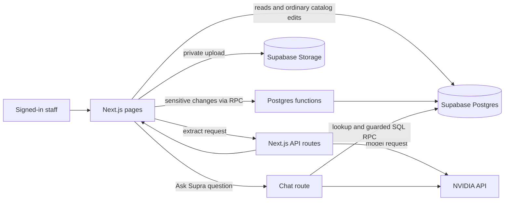
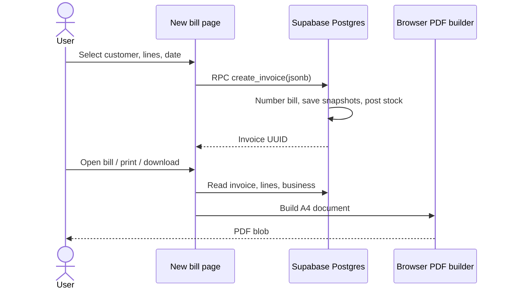
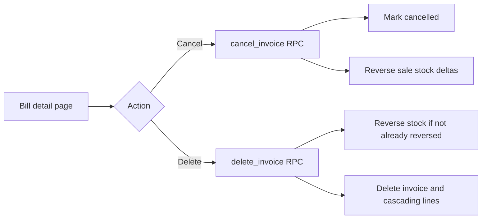
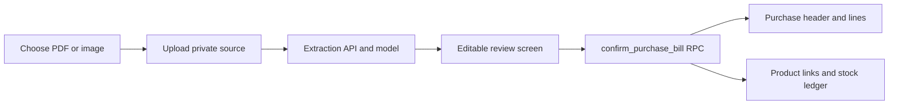
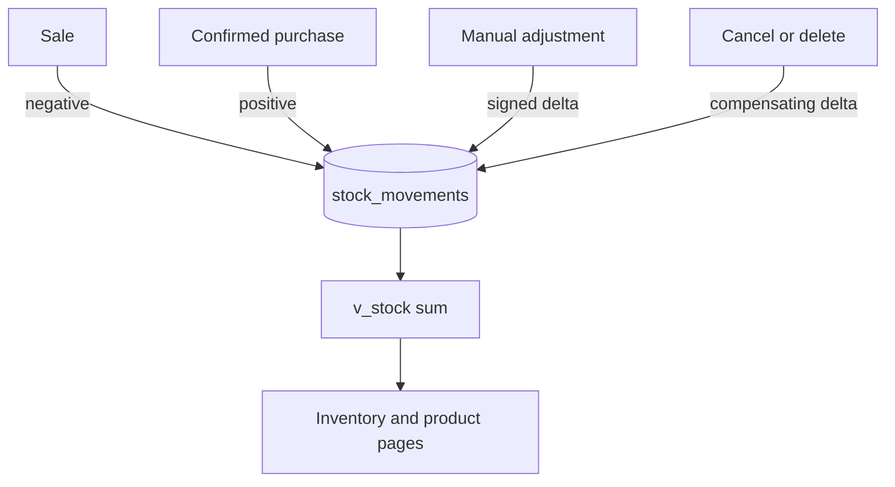
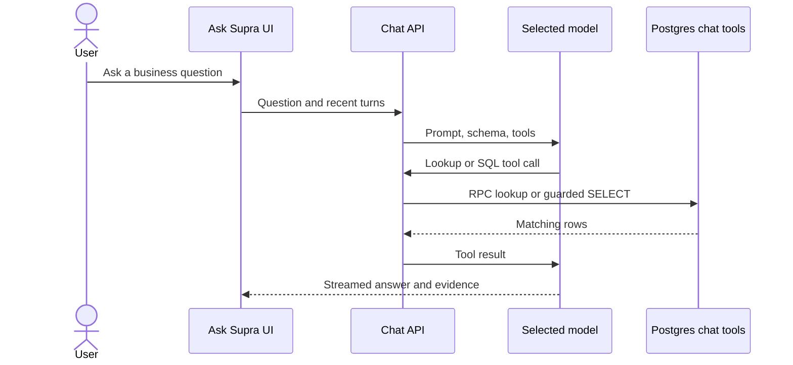
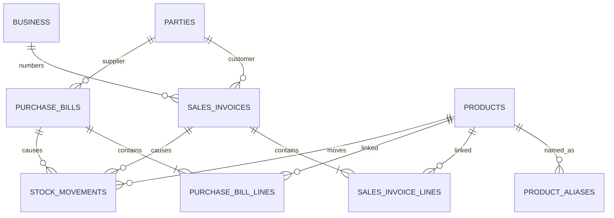
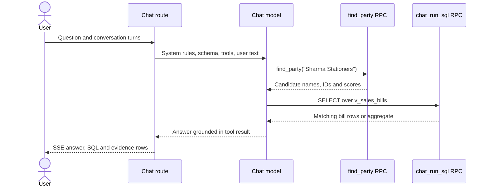

# Supra Billing, explained

> **Update (Nov 2026):** the database is now defined by versioned migrations in `supabase/migrations/` (see `supabase/README.md` and `docs/DATABASE.md`). Mentions of `reset_and_rebuild.sql` below describe the earlier, retired setup.

## Table of contents

1. [The project in one page](#1-the-project-in-one-page)
2. [Tech stack, simply](#2-tech-stack-simply)
3. [Big picture flow](#3-big-picture-flow)
4. [Data model and database](#4-data-model-and-database)
5. [Where the data comes from](#5-where-the-data-comes-from)
6. [Purchase bill extraction deep dive](#6-purchase-bill-extraction-deep-dive)
7. [RAG architecture deep dive](#7-rag-architecture-deep-dive)
8. [Security and privacy walkthrough](#8-security-and-privacy-walkthrough)
9. [Limits and known weak spots](#9-limits-and-known-weak-spots)
10. [Glossary](#10-glossary)
11. [How to explain this project in 2 minutes](#11-how-to-explain-this-project-in-2-minutes)
12. [File map](#12-file-map)

## 1. The project in one page

Supra Billing is a phone-first billing and inventory app for one wholesale stationery business. A signed-in staff member can maintain customers and products, make GST sales invoices, record supplier bills from PDFs or images, track stock, and ask questions about business records in English, Hindi, Marathi, or Romanized language. Think of it as a shop ledger with a clerk: PostgreSQL is the ledger, the screens are the counter, and Ask Supra is a clerk who looks up ledger entries before answering. (Evidence: `README.md`, `app/`, `supabase/reset_and_rebuild.sql`.)

| Feature | What it does | Main page/files |
| --- | --- | --- |
| Home and today’s sales | Shows app shortcuts and today’s final invoice total | `app/page.tsx` |
| Sales invoices and PDF | Creates numbered invoices, then downloads, prints, or shares a locally generated PDF | `app/bill/new/page.tsx`, `app/bills/`, `lib/pdf.ts` |
| Customers | Creates and edits customer parties | `app/customers/page.tsx` |
| Products and inventory | Maintains product catalog and reads ledger-derived stock | `app/products/page.tsx`, `app/inventory/page.tsx` |
| Supplier purchases | Saves source document, extracts candidate fields, lets a person review, then records a purchase | `app/purchase-bills/page.tsx`, `app/api/purchase-bills/extract/route.ts` |
| Ask Supra | Answers questions using database lookups and SQL over approved views | `app/ask-supra/page.tsx`, `app/api/rag/chat/route.ts` |
| Business settings and sign-in | Stores invoice header details and next invoice number; Supabase Auth sign-in | `app/settings/page.tsx`, `app/login/page.tsx` |

**Models in use** (defaults are from `.env.example` and route code; env values override defaults.)

| Task/provider | Config key | Current default | Properties present in this repo |
| --- | --- | --- | --- |
| Ask Supra and purchase extraction, NVIDIA via OpenRouter | `OPENROUTER_CHAT_MODEL` / `OPENROUTER_EXTRACTION_MODEL` | `nvidia/nemotron-3.5-super-vl` | OpenRouter’s OpenAI-compatible gateway routes to NVIDIA; chat uses tools and streaming, while purchase extraction sends a JPEG image and expects JSON text. Context/rate/pricing specs: check provider docs. |

## 2. Tech stack, simply

| Technology | What it is | Why it is here | Costs and limits documented in repo |
| --- | --- | --- | --- |
| Next.js 15, React 19, TypeScript | Web app framework, UI library, typed JavaScript | Pages, client screens, and server API routes in one project | No license or hosting cost documented. |
| Supabase Postgres | Managed relational database | Stores business records and runs SQL/RPC functions | Hosted plan limits not documented. |
| Supabase Auth | Sign-in service | Supplies signed-in user identity and access token | Signup is intended to be disabled; no pricing documented. |
| Supabase Storage | Managed file storage | Private `purchase-documents` bucket for uploaded source bills | 10 MB limit and PDF/JPEG/PNG/WebP MIME allowlist are configured in SQL. |
| Supabase JS | Browser/server database client | Reads/writes records and calls Postgres functions | Version is in `package.json`; provider pricing not documented. |
| PostgreSQL functions/RPC | Named database routines callable over Supabase | Keep invoice, purchase, stock, and safe chat operations together | Runs in the configured Supabase project. |
| NVIDIA API | OpenAI-compatible model API | Ask Supra and purchase extraction | Rate limits, quotas, and cost may change; check NVIDIA docs. |
| jsPDF + jsPDF-AutoTable | Browser-side PDF libraries | Draw A4 tax invoice and item rows | No runtime PDF server endpoint. |
| `pdf-img-convert`, `@napi-rs/canvas` | PDF page rasterization and canvas implementation | Convert the first PDF page to JPEG for NVIDIA vision input | Rasterization uses scale 2; only the first page is currently extracted. |
| `pg_trgm`, `unaccent` extensions | PostgreSQL text matching helpers | Trigram similarity indexes; unaccent is installed | No embedding provider or vector database used. |

## 3. Big picture flow



Read left to right: a person uses the pages; the pages and server routes contact Supabase or a model provider. Database functions protect important multi-step changes, and Ask Supra sends only read queries through its chat database role. (`app/`, `app/api/`, `supabase/reset_and_rebuild.sql`.)

### (a) Creating a sales bill and its PDF



The arrows show calls and returned values; the PDF is made in the browser from saved values, not stored as a generated file. (`app/bill/new/page.tsx`, `app/bills/[id]/page.tsx`, `lib/pdf.ts`.)

1. `app/bill/new/page.tsx` loads `parties`, active `products`, and `business`. The person selects a customer and enters invoice date, optional challan/PO, and item quantity/rate/GST.
2. The page calls `create_invoice` RPC with customer ID and item JSON. The function locks the single `business` row, allocates `next_invoice_no`, validates quantities/rates/GST, computes line and bill amounts, and writes `sales_invoices`, `sales_invoice_lines`, and negative `stock_movements` for tracked products. It returns the invoice UUID. A tracked product cannot be sold below available stock.
3. `app/bills/[id]/page.tsx` loads invoice, lines, and business header. `lib/pdf.ts:buildInvoiceDoc` renders A4 with jsPDF; `buildInvoicePdf` returns a Blob. Cancelled invoices receive a watermark. Share uses the generated PDF where Web Share file support exists; otherwise the page offers print/download behavior.

### (b) Cancelling/deleting a bill



Each branch starts at the bill detail page. The reversal is an added ledger entry; deletion removes the bill and its dependent lines. (`app/bills/[id]/page.tsx`, SQL functions in `supabase/reset_and_rebuild.sql`.)

1. `cancel_invoice(p_id)` requires a signed-in caller, changes `final` to `cancelled`, and inserts opposite `deletion` movements for original sale movements. It rejects missing/already-cancelled bills.
2. `delete_invoice(p_id)` requires sign-in, writes a compensating stock movement if one has not already been written for that bill, then deletes the invoice; line rows cascade. This is permanent. Both operations happen in the database transaction.

### (c) Uploading a purchase bill



The uploaded file is kept in private Storage, and extracted data is only a proposal until reviewed and confirmed. A successful confirmation stores bill rows and receives stock for tracked linked products. (`app/purchase-bills/page.tsx`, extraction route, SQL.)

1. Browser checks file selection UI, then uploads at `<auth user id>/<random UUID>-<sanitized filename>` to private bucket `purchase-documents`.
2. Browser sends the same file and selected provider to `POST /api/purchase-bills/extract` with the Supabase bearer token. The route verifies the token and file type/size, asks the model, normalizes/validates JSON, and returns candidate fields. This response itself is not persisted.
3. `app/purchase-bills/page.tsx` shows editable header, totals, and each line. A user can link an existing product or create a stock-tracked product. “Discard review” discards the edited values, but the source upload remains in Storage unless later deleted through a saved purchase flow.
4. Confirm calls `confirm_purchase_bill(jsonb)`. The function upserts a supplier party, writes the purchase header and normalized line rows, resolves/creates products by exact name/alias, and adds positive stock movements when the product tracks stock. The extraction metadata JSON is stored on the purchase header.

### (d) Stock movements



The ledger keeps each cause as a row; the displayed balance is the sum of signed quantities. This makes changes auditable and reversible. (`supabase/reset_and_rebuild.sql`, `app/inventory/page.tsx`, `app/products/page.tsx`.)

The stock view sums all `qty_delta` values by product. Sales subtract; purchases add; `adjust_stock` accepts a nonzero signed delta with a reason and prevents a negative balance; clear-stock creates an adjustment. The schema has no mutable stock quantity column on `products`.

### (e) Asking Ask Supra



The model proposes which approved lookup to make, while Postgres returns the facts. The UI can show executed SQL/rows under “How I got this” and links to related sales bills. (`components/AskSupraContext.tsx`, `components/AskSupraChat.tsx`, `app/api/rag/chat/route.ts`.)

## 4. Data model and database

### ER diagram



Each line item belongs to one bill; optional product links connect historical line descriptions to the current catalog. Party links can be null after a party is deleted, but invoice snapshots retain their printed identity. `v_stock` is derived from movement rows. (Schema in `supabase/reset_and_rebuild.sql`.)

### Tables

Types and constraints below reflect the SQL definitions. UUID values and timestamps are generated by PostgreSQL unless noted. “Example” values illustrate the field’s shape, not a guarantee about current records.

| Table | Column | Type; constraints | Meaning / example |
| --- | --- | --- | --- |
| `business` | `id` | int PK, check = 1 | One business row; `1` |
| | `name`, `address1`, `address2`, `phone`, `gstin`, `pan`, `bank_name`, `bank_account`, `bank_ifsc`, `declaration` | text; name NOT NULL | Invoice seller and payment details; text or NULL |
| | `next_invoice_no` | int NOT NULL, >0, default 5601 | Next allocated number; `5601` |
| | `created_at`, `updated_at` | timestamptz NOT NULL | Creation/update times |
| `parties` | `id` | uuid PK | Customer/supplier identity |
| | `kind` | text NOT NULL, customer/supplier/both | How the party is used |
| | `name` | text NOT NULL, trimmed nonempty; unique case-insensitive index | Party name |
| | `gstin`, `address`, `address1`, `address2`, `phone` | text nullable | Tax/contact details |
| | `created_at`, `updated_at` | timestamptz NOT NULL | Timestamps |
| `products` | `id` | uuid PK | Product identity |
| | `name` | text NOT NULL, unique, trimmed nonempty | Catalog name |
| | `hsn` | text NOT NULL default `4820` | HSN code |
| | `rate` | numeric(12,2) >=0, default 0 | Suggested sales rate |
| | `gst` | numeric(5,2), 0–28, default 0 | GST percent |
| | `track_stock`, `active` | boolean NOT NULL, defaults false/true | Ledger tracking and catalog visibility |
| | `created_at`, `updated_at` | timestamptz NOT NULL | Timestamps |
| `product_aliases` | `id` | uuid PK | Alias row identity |
| | `product_id` | uuid NOT NULL FK products, cascade delete | Product this wording names |
| | `alias` | text NOT NULL, trimmed nonempty | Alternate product wording |
| | `created_at`, `updated_at` | timestamptz NOT NULL | Timestamps |
| | `(product_id, alias)` | unique pair | Avoid duplicate alias on same product |
| `sales_invoices` | `id` | uuid PK | Invoice identity |
| | `invoice_no` | int NOT NULL UNIQUE | Human invoice number |
| | `invoice_date` | date NOT NULL | Issue date |
| | `challan_no`, `po_no` | text nullable | Optional references |
| | `customer_id` | uuid FK parties, ON DELETE SET NULL | Current party link |
| | `customer_name` | text NOT NULL | Customer name snapshot |
| | `customer_gstin`, `customer_address1`, `customer_address2` | text nullable | Customer detail snapshots |
| | `subtotal`, `cgst`, `sgst`, `total` | numeric(14,2) NOT NULL, nonnegative | Bill totals; total equals subtotal + taxes + round_off |
| | `round_off` | numeric(6,2) NOT NULL | Difference to whole-rupee total |
| | `status` | text NOT NULL, final/cancelled, default final | Invoice state |
| | `created_at`, `updated_at` | timestamptz NOT NULL | Timestamps |
| `sales_invoice_lines` | `id` | uuid PK | Line identity |
| | `invoice_id` | uuid NOT NULL FK invoice, cascade delete | Parent bill |
| | `position` | int >0; unique per invoice | Display order |
| | `product_id` | uuid FK products, ON DELETE SET NULL | Optional current catalog link |
| | `description` | text NOT NULL | Printed line description snapshot |
| | `hsn` | text nullable | Line HSN snapshot |
| | `gst` | numeric(5,2), 0–28, default 0 | GST rate snapshot |
| | `qty` | numeric(12,3) >0 | Quantity |
| | `rate` | numeric(12,2) >=0 | Unit rate snapshot |
| | `amount`, `cgst`, `sgst` | numeric(14,2) NOT NULL, nonnegative | Amount and tax amounts |
| | `total` | numeric(14,2) >=0, equals amount+cgst+sgst | Line total |
| | `created_at`, `updated_at` | timestamptz NOT NULL | Timestamps |
| `purchase_bills` | `id` | uuid PK | Purchase identity |
| | `supplier_id` | uuid FK parties, ON DELETE SET NULL | Supplier link |
| | `supplier_name` | text NOT NULL | Supplier snapshot |
| | `supplier_gstin`, `supplier_address` | text nullable | Supplier details snapshot |
| | `supplier_invoice_number` | text NOT NULL | Supplier’s bill number |
| | `purchase_date` | date NOT NULL | Purchase date |
| | `purchase_order_number`, `challan_number` | text nullable | Optional references |
| | `subtotal`, `tax_total`, `grand_total` | numeric(14,2), nullable and nonnegative | Printed amounts; nullable to retain missing values |
| | `round_off` | numeric(6,2) nullable | Printed round-off |
| | `status` | text NOT NULL, confirmed/cancelled, default confirmed | Purchase state |
| | `extraction_metadata` | jsonb NOT NULL default `{}` | Provider/model/review metadata |
| | `source_file_path` | text nullable | Storage object path |
| | `created_at`, `updated_at` | timestamptz NOT NULL | Timestamps |
| | `(supplier_id, supplier_invoice_number)` | unique pair | Duplicate supplier invoice guard (nullable supplier behavior follows PostgreSQL) |
| `purchase_bill_lines` | `id` | uuid PK | Line identity |
| | `purchase_bill_id` | uuid NOT NULL FK bill, cascade delete | Parent purchase |
| | `position` | int >0; unique per bill | Display order |
| | `product_id` | uuid FK products, ON DELETE SET NULL | Optional catalog link |
| | `description` | text NOT NULL | Printed description snapshot |
| | `hsn`, `unit` | text nullable | HSN and unit as printed |
| | `quantity` | numeric(12,3) >0 | Received quantity |
| | `unit_rate`, `line_total` | numeric(12,2), nullable/nonnegative | Printed line amounts |
| | `gst_rate` | numeric(5,2), nullable 0–28 | GST percentage |
| | `cgst`, `sgst`, `igst` | numeric(14,2), nullable/nonnegative | Tax components as printed |
| | `created_at`, `updated_at` | timestamptz NOT NULL | Timestamps |
| `stock_movements` | `id` | uuid PK | Ledger row identity |
| | `product_id` | uuid NOT NULL FK products, ON DELETE RESTRICT | Product moved |
| | `qty_delta` | numeric(14,3) NOT NULL, nonzero | Signed change: e.g. `-2` sale, `+10` purchase |
| | `reason` | text NOT NULL | Human explanation |
| | `ref_type` | text NOT NULL: sale/purchase/adjustment/deletion | Movement category |
| | `ref_id` | uuid nullable | Related bill when applicable |
| | `created_at` | timestamptz NOT NULL | Movement time |

### Views

Views are saved read queries, like labeled windows onto the underlying tables. These nine are the complete approved Ask Supra query surface. Types below come from the selected expressions in SQL; inferred types are marked from the expression.

| View | Columns (type → meaning) |
| --- | --- |
| `v_stock` | `product_id` uuid → product; `name` text → current name; `active` bool → active catalog flag; `track_stock` bool → tracking flag; `stock_qty` numeric(14,3) → sum of movement deltas. |
| `v_sales_lines` | `invoice_id` uuid, `invoice_no` int, `invoice_date` date, `is_cancelled` bool, `customer_name` text, `customer_gstin` text, `position` int, `product_id` uuid, `product_name` text, `hsn` text, `quantity` numeric(12,3), `rate` numeric(12,2), `gst_rate` numeric(5,2), `amount`/`cgst`/`sgst`/`line_total` numeric(14,2). One row per sales line. |
| `v_purchase_lines` | `purchase_bill_id` uuid, `supplier_name` text, `bill_no` text, `purchase_date` date, `is_cancelled` bool, `position` int, `product_id` uuid, `product_name` text, `hsn` text, `quantity` numeric(12,3), `unit` text, `unit_rate` numeric(12,2), `line_total` numeric(14,2), `gst_rate` numeric(5,2), `cgst`/`sgst`/`igst` numeric(14,2). One row per purchase line. |
| `v_sales_bills` | `id` uuid, `bill_no` int, `bill_date` date, `party_id` uuid, `party_name` text, `party_gstin` text, `customer_address1`/`customer_address2` text, `subtotal`/`cgst`/`sgst`/`round_off`/`total` numeric, `status` text, `is_cancelled` bool, `challan_no`/`po_no` text. One row per sales bill. |
| `v_purchase_bills` | `id` uuid, `party_id` uuid, `party_name` text, `party_gstin` text, `bill_no` text, `bill_date` date, `subtotal`/`tax_total`/`round_off`/`total` numeric, `status` text, `is_cancelled` bool, `purchase_order_number`/`challan_number` text. One row per purchase bill. |
| `v_party_summary` | `id` uuid, `kind`/`name`/`gstin`/addresses/`phone` text, `sales_bill_count` bigint, `sales_total` numeric, `purchase_bill_count` bigint, `purchase_total` numeric. Totals include final sales and confirmed purchases; counts include all linked bills. |
| `v_product_summary` | `id` uuid, `name`/`hsn` text, `rate` numeric(12,2), `gst` numeric(5,2), `track_stock`/`active` bool, `current_stock` numeric(14,3), `total_sold`/`total_purchased` numeric, `last_sale_rate`/`last_purchase_rate` numeric. |
| `v_monthly_sales` | `month_start` date, `bill_count` bigint (includes cancelled), `sales_total` numeric (final only), `cancelled_total` numeric (cancelled only). |
| `v_monthly_purchases` | `month_start` date, `bill_count` bigint, `purchase_total` numeric (confirmed only). |

`v_stock` is also an operational view and is included in that count: the listed nine are `v_stock`, `v_sales_lines`, `v_purchase_lines`, `v_sales_bills`, `v_purchase_bills`, `v_party_summary`, `v_product_summary`, `v_monthly_sales`, and `v_monthly_purchases`.

### Why the schema is shaped this way

- **Snapshots:** sales invoices copy customer name, GSTIN, and addresses; line rows copy description, HSN, GST, and rate. Old invoices therefore retain what was printed even if a customer or product is renamed later.
- **Stock ledger:** each sale, purchase, correction, or reversal is recorded. Current stock is a sum, which preserves the reason and history of each change rather than overwriting one number.
- **Normalized lines:** bills and their line items live in separate related tables so a bill can contain many lines and each line can be queried independently.
- **Unified parties:** one `parties` table represents customers, suppliers, or both; purchases can turn an existing same-name customer into `both`.
- **Views:** views make SQL answers easier to interpret and give the chat role a narrow, documented surface. SQL comments describe view and column semantics, then `chat_schema_description()` supplies those comments to the prompt.

### Database functions and RPCs

| Function | What it does / changes | Caller |
| --- | --- | --- |
| `create_invoice(jsonb)` | Validates and atomically creates invoice/lines, computes totals, consumes tracked stock, advances invoice sequence; returns UUID. | Authenticated UI via Supabase RPC. |
| `cancel_invoice(uuid)` | Marks final bill cancelled and posts compensating stock movement. | Authenticated UI. |
| `delete_invoice(uuid)` | Posts reversal if needed, deletes bill; lines cascade. | Authenticated UI. |
| `confirm_purchase_bill(jsonb)` | Upserts supplier; creates purchase, lines/products as needed, and positive tracked-stock movements; validates source path belongs to caller’s folder. | Authenticated UI. |
| `delete_purchase_bill(uuid)` | Prevents stock going negative, posts reversal, deletes bill, returns source path. | Authenticated UI; page then removes the Storage object. |
| `adjust_stock(uuid,numeric,text)` | Adds signed nonzero adjustment with reason; prevents negative result. | Authenticated UI (granted). |
| `clear_product_stock(uuid)` | Posts an adjustment to bring current balance to zero. | Authenticated UI (granted). |
| `remove_product(uuid)` | Archives a used product; permanently deletes an unused one; returns `archived` or `deleted`. | Authenticated UI. |
| `chat_run_sql(text)` | Executes constrained read-only SQL as `chat_reader`, returns JSON rows. | Authenticated chat route; execute granted to authenticated. |
| `find_party(text)` | Fuzzy-matches party name, returns up to 8 candidates and similarity score. | Chat route. |
| `find_product(text)` | Fuzzy-matches product or alias, returns up to 8 candidates, stock and score. | Chat route. |
| `chat_schema_description()` | Returns approved views, columns, types and SQL comments. | Chat route. |
| `touch_updated_at()` | Trigger helper that stamps `updated_at`. | Database triggers; not a client RPC. |

`chat_reader` is a non-login database role with select access to analytics views. `chat_run_sql` is owned by that role and runs as a security definer. In analogy, staff can use the full ledger screens, but the chat clerk gets a key to read only prepared report windows; even a mistakenly destructive sentence cannot write through this route.

## 5. Where the data comes from

| Source | Entry path | What is saved |
| --- | --- | --- |
| Schema and seed | `supabase/migrations/*.sql`, `supabase/seed.sql` | One business row, 53 party/customer rows, 38 product rows (documented in README); inspect seed INSERT statements in the SQL for current names. |
| Manual customer entry | `app/customers/page.tsx` writes `parties` | Name, kind, GSTIN and addresses. |
| Manual product entry | `app/products/page.tsx` writes `products` | Catalog details, suggested rate/GST, tracking/active flags. |
| Sales invoice | `app/bill/new/page.tsx` -> `create_invoice` | Invoice snapshot, normalized lines, and stock movement rows. |
| Uploaded bill | `app/purchase-bills/page.tsx` | Original file in Storage; user-reviewed header/lines only become database records at confirmation. |
| AI extraction | `/api/purchase-bills/extract` | Candidate JSON response and extraction metadata at confirmation; model output is not automatically trusted or saved before confirmation. |
| User questions | Ask Supra chat route | Question/history are sent to configured model in request; answers and evidence are in UI memory. The code does not persist chat history in Postgres. |

Seed examples from `supabase/seed.sql`: customer `Amar Book Centre` and `Baldota Stationery`; products `A4 Spiral Book 300 Pgs Ruled` and `NEET OMR 50 Sheets`. These are initial seed records; live data may differ.

## 6. Purchase bill extraction deep dive

Extraction is an assistant that fills a draft, not an automatic accounting decision. The person reviews and edits values before `confirm_purchase_bill` writes them. (`app/purchase-bills/page.tsx`; `app/api/purchase-bills/extract/route.ts`.)

1. UI accepts PDF, JPEG, PNG, or WebP up to 10 MB. Storage bucket independently allows the same types and limit.
2. API `POST` requires a bearer token, verifies it with `supabase.auth.getUser()`, and enforces provider selection, MIME type and byte size. A 60-second abort timer bounds provider work.
3. **NVIDIA path:** images pass through in their original format. PDFs are rasterized by `renderFirstPdfPageAsJpeg` using `pdf-img-convert` with `page_numbers: [1]` and `scale: 2`, then re-encoded as `image/jpeg` before being sent to NVIDIA. Only the first page is currently extracted.
5. The prompt says extract visible facts only, use null when absent, preserve stated taxes, use ISO dates and emit only JSON. Fields: supplier name/GSTIN/address/invoice number/date/PO/challan, items (description, HSN, quantity, unit, unit rate, line total, GST rate, CGST/SGST/IGST), and subtotal/tax/round-off/grand total.
6. NVIDIA receives a strict extraction prompt. `parseModelJson` accepts raw JSON, strips a code fence, or locates a JSON object inside surrounding text. `normalizeExtraction` fills missing expected keys with null. `validExtraction` checks required shapes, date format, finite numeric values, and at most 500 items. It does not prove that OCR matches the document or reconcile arithmetic.
7. Response includes `source_filename` and extraction metadata (`method`, actual configured model, timestamp, pending status, schema version). UI lets user edit fields and match products. Confirmation requires supplier, invoice number, date, at least one valid described line and quantity, and either a unit rate or line total. Duplicate supplier invoice pair is rejected by database uniqueness.

Failure handling: unsupported/oversized file returns 400; missing provider key returns 503; invalid sign-in returns 401; model rate limit, timeout, malformed JSON, missing readable first PDF page, and invalid structure return a readable error (usually 502). Provider key patterns are redacted from surfaced error text. Extraction failure leaves the uploaded source object in private storage; code does not automatically clean it up in that branch. A line with no selected product can become a new tracked product during confirmation by exact description, or be created earlier from the review screen.

JSON shape (all fields can be null except `items`, which is an array):

```json
{
  "supplier_name": "Example Supplier",
  "supplier_gstin": null,
  "supplier_address": null,
  "supplier_invoice_number": "S-104",
  "purchase_date": "2026-10-01",
  "purchase_order_number": null,
  "challan_number": null,
  "items": [{
    "description": "Notebook",
    "hsn": "4820",
    "quantity": 10,
    "unit": "pcs",
    "unit_rate": 25,
    "line_total": 250,
    "gst_rate": 12,
    "cgst": 15,
    "sgst": 15,
    "igst": null
  }],
  "subtotal": 250,
  "tax_total": 30,
  "round_off": 0,
  "grand_total": 280
}
```

## 7. RAG architecture deep dive

### RAG, from scratch

RAG means “retrieve, then generate.” A clerk first finds relevant ledger records, then explains them in natural language. The model is not expected to memorize the business database. Supra retrieves structured rows from PostgreSQL and asks a model to phrase a response grounded in those rows.

There are two common retrieval patterns:

| Approach | Best for | Weakness | Cost / speed | Accuracy on numbers |
| --- | --- | --- | --- | --- |
| Embedding/vector search over text chunks | Finding semantically similar notes/documents when wording differs | Does not naturally compute exact totals, filters, counts, or date groupings | Needs embedding generation/storage/index; search is usually quick | Weak for sums/counts unless followed by structured calculation |
| Text-to-SQL over structured data | Exact bills, products, dates, quantities, totals, grouping | Model can write wrong SQL or misunderstand intent; needs strict guardrails | No embedding API/index; database executes exact arithmetic; query speed depends on schema/indexes | Strong when correct SQL and data are present |

### What this repo uses now and before

**Today:** structured PostgreSQL retrieval, fuzzy name lookup, documented analytics views, and guarded text-to-SQL. There is no embedding model call, vector column, vector index, ingestion queue, or active embedding search path. The current SQL reset drops legacy objects named `bill_embeddings`, `bill_embedding_jobs`, and functions such as `search_bill_embeddings`; this is evidence those artifacts existed in an earlier design, not that they are active. `MIGRATION_NOTES.md` documents the migration to view-based SQL and says embeddings/indexing are no longer used. This checkout has no readable Git history (`git log` reports that it is not a Git repository), so finer historical details or exact prior behavior are **Not clear from code**.

The practical reason is that “total sales last month?” needs a database sum, and “how many invoices?” needs a count. Similarity search can find relevant text, but it is not a reliable calculator. SQL views also avoid the cost and maintenance of embeddings/indexing. Free-tier and paid-provider quotas vary; the repo documents no specific quota as the reason, so that explanation is **Not clear from code** beyond the migration notes’ general mention of free-tier constraints.

### One question end to end

Example questions: “What was the total billed to Sharma Stationers in March 2026?” / “मार्च २०२६ में शर्मा स्टेशनर्स को कुल कितने का बिल दिया?” / “March 2026 madhe Sharma Stationers la ekun kiti billing zali?” Real customer/product spellings vary; use the canonical names actually returned by seed/party lookups. No unverified customer name or numeric answer is asserted here.



The model receives an instruction summary: answer in the user’s language/script; use tools for factual claims; do not invent; treat record text as untrusted; use India date/rupee conventions; resolve entity names first; exclude cancelled bills unless asked; use approved views; let PostgreSQL calculate totals; explain row caps; do not answer historical stock from current balance. The route appends today’s Asia/Kolkata date and schema descriptions/comments. (Exact prompt is `systemBase` in `app/api/rag/chat/route.ts`.)

For this example, tools are `find_party` then `run_sql`. A representative query shape is:

```sql
select party_name, sum(total) as sales_total
from v_sales_bills
where party_id = '<resolved-party-uuid>'
  and bill_date >= date '2026-03-01'
  and bill_date < date '2026-04-01'
  and is_cancelled = false
group by party_name;
```

The UUID is a lookup result, not guessed input. The database returns an aggregate row such as `{ "party_name": "...", "sales_total": ... }`; the actual value depends on the live database and is not stated here. A zero-row result is explained as no matching records. The exact output is sent back as a tool result before the model writes its response.

#### SQL sandbox checks

`lib/rag/sql-guard.ts:guardChatSql` checks before the RPC: (1) nonempty and at most 12,000 characters; (2) only printable ASCII plus whitespace; (3) rejects SQL comments, dollar signs, backslashes, and double quotes; (4) strips one optional trailing semicolon and rejects any other semicolon; (5) requires first command `SELECT` or `WITH`; (6) rejects mutation/DDL/admin keywords, system catalogs, dangerous helpers such as `set_config`, dblink and large-object import/export; (7) rejects direct references to base-table names; (8) requires at least one approved `v_*` view and rejects any unapproved `v_*` identifier.

`chat_run_sql(q)` in SQL adds database-side checks: query length and ASCII checks, comment/semicolon and mutation/admin keyword checks, approved view requirement, then sets transaction-local `statement_timeout` to 3 seconds, wraps the query with `limit 200`, executes under the `chat_reader` owner, converts rows to JSON, and returns them. The database guard is independent of the TypeScript guard. SQL is extracted after stripping quoted literals for the keyword checks; approved view names are explicitly enumerated. (See exact function body in `supabase/reset_and_rebuild.sql`.)

#### Fast paths

Before calling an LLM, the route handles two patterns directly. For a recognized exact sales bill number, it queries `v_sales_bills`, fetches the matching `v_sales_lines`, formats the answer, and returns SQL evidence. For a short stock, inventory, or balance question about a product that is not classified as time-related, it resolves the product with `find_product` and reads `v_product_summary.current_stock`. These deterministic paths avoid model/tool overhead. They cover only the patterns coded in the route; unmatched phrasing falls through to the normal model flow.

#### Entity retrieval, schema and row limits

`find_party` and `find_product` use PostgreSQL `pg_trgm` similarity plus substring matching (`ILIKE`). They return up to eight candidates. `similarity()` is a score from 0 to 1: higher means more trigram overlap, not “this answer is 90% true.” Product lookup compares catalog names and aliases and takes the stronger score. Alias rows are maintained in `product_aliases`; current SQL shows no customer alias table.

`chat_schema_description()` reads the names, types, and SQL comments of `v_*` views. The chat route caches that description in a process-level promise, then appends it to system context. View comments explain semantic gotchas such as cancelled rows and computed stock. SQL is generated against those views, not raw tables. The database caps any query at 200 rows; the prompt says 60 or more is a preview and 200 may mean truncation. Aggregates should be computed in SQL before returning that preview.

#### Provider choice, fallback and conversation

The UI requests `/api/rag/chat` GET to discover the configured NVIDIA model. POST uses that single model; there are no provider-selection buttons or alternate-provider fallback. Model calls allow up to five tool calls per pass; model requests use tool calling, low temperature, and up to 2,000 output tokens. A model response without tool calls streams through SSE. Client history is sanitized to a bounded set of recent turns (see `safeTurns` in the route); the code does not save it in the database.

#### Safety boundaries

Stored names/descriptions/results are explicitly treated by the prompt as data, not instructions. The answer prompt itself is still supplied to a model, and prompt injection cannot be completely solved by wording alone. The stronger boundary is the read-only database role, views-only permissions, two SQL guards, and timeout/row cap. Requests use the signed-in Supabase token; SQL functions are granted to authenticated users. The database does not use a service-role key for chat. The repo does not show per-user row ownership for business tables: authenticated users share one dataset by design. **Not clear from code:** provider-side retention/training settings and any network-layer rate limiting; no application rate limiter is present in the chat route.

### Embeddings, even though this repo does not use them

An embedding turns text into a list of numbers—coordinates on a map of meaning. Similar passages tend to sit near each other. Dimensions (384, 768, 1,024, 3,072, for example) are the number of coordinates; they do not directly mean quality or context size. Cosine similarity compares the angle between vectors, often producing a similarity ranking.

Chunking splits long documents into smaller overlapping passages so a search can return only the relevant piece. HNSW and IVFFlat are approximate-nearest-neighbor vector index methods that trade some exactness/memory or build cost for faster search. Hybrid search combines lexical ranking such as BM25 (word matching) with vector similarity. Reranking takes an initial set of candidates and scores them again with a stronger relevance model.

This project might add embeddings if users need semantic search across free-text notes or scanned bill descriptions that vary greatly in wording. Exact invoice totals should still come from SQL. There is no embedding model configuration in the active code; old embedding object names in the reset are cleanup only. Any provider/model dimensions or costs would need to be checked before adding one.

### LLM terms decoded

| Term | Plain meaning |
| --- | --- |
| Parameter count (`70B`) | Rough count of learned model weights; `B` means billion. It is not a guaranteed quality score. |
| `flash`, `lite`, `pro`, `versatile`, `instruct`, `turbo` | Provider/model naming tiers or training labels; exact meaning is provider-specific. Check provider docs. |
| Context window | Maximum input material a model can consider for one request, often measured in tokens. Not specified in repo; check provider docs. |
| Max output tokens | Upper bound for generated response; chat route sets 2,000. |
| Temperature | Sampling randomness; lower values tend to be more repeatable. Chat route uses 0.1 for tool turns, 0.2 for its streaming completion. NVIDIA extraction uses 0.1. |
| Tool/function calling | Model asks the server to run a named function such as `find_product` or `run_sql`; server checks and returns results. |
| Streaming / SSE | Server sends answer text in small events while it is generated. |
| Reasoning effort | Provider-specific control over deliberation; route adds provider-specific options only when applicable. Exact model support: check provider docs. |
| RPM / TPM / RPD | Provider limits per minute for requests, tokens, or per day. Not configured/documented here; check provider docs. |
| Free tier / paid | NVIDIA plan and model billing terms; can change. Check current NVIDIA provider docs. |

For the exact configured model IDs, see the single “Models in use” table in section 1. Repo code does not establish their context windows, parameter counts, provider quotas, price, training data, or retention policy; check provider docs for each.

## 8. Security and privacy walkthrough

- **Authentication:** app data uses Supabase’s anon key plus the signed-in user session; extraction verifies the bearer token server-side. README instructs creating a login and disabling public email signups. There is no app-wide route middleware visible in the repo, so individual page access enforcement beyond Supabase data policies is **Not clear from code**.
- **RLS:** SQL enables row-level security on all nine application tables (`business`, `parties`, `products`, `product_aliases`, `sales_invoices`, `sales_invoice_lines`, `purchase_bills`, `purchase_bill_lines`, `stock_movements`). Authenticated users can select rows; parties/products/aliases have authenticated write policies; business allows update. Invoice/purchase/stock direct writes are revoked from authenticated users and go through functions. This is shared-business access, not tenant isolation.
- **Chat role:** `chat_reader` has select on the nine analytics views and their view policies, no direct base-table access. Its role is `NOLOGIN`; `chat_run_sql` executes with this owner. The function’s results are bounded by approved view names, a 3-second timeout, and 200 rows.
- **Storage:** `purchase-documents` is private, 10 MB, and MIME-limited. Upload/read/delete policies require the first path segment to equal `auth.uid()`. Purchase confirmation also checks that the stored source path begins with the caller’s user ID. The purchase delete RPC returns the path; the UI removes the object afterward, so Storage removal is a separate step and may fail after the bill is deleted.
- **Secrets:** `.env.example` names client Supabase URL/anon key and the server-only NVIDIA key. Never commit or include `.env.local` or provider secrets in a zip. Provider keys are not prefixed `NEXT_PUBLIC_`; README explicitly says not to expose them. The reset script does not manage secrets.
- **Owner checks:** rotate any key ever committed/shared; restrict provider keys and monitor usage; verify signup is disabled; verify Storage bucket is private; review all shared users because each authenticated account shares business records; use the destructive reset only on intended disposable database (per `MIGRATION_NOTES.md`).

**RLS analogy:** each table is a room with a door policy. Signed-in staff can read the shared shop records, while database functions are the guarded counter for important writes. The chat account has a separate key to prepared reports only.

## 9. Limits and known weak spots

- Model slugs, availability, quotas, free tiers and prices change; repo documentation explicitly says check NVIDIA provider docs.
- LLM-written SQL can choose a wrong view, filter, date range or interpretation. Guards limit damage, not business-logic mistakes; the UI exposes SQL and returned rows for review.
- Text extraction can misread a scan. Validation checks shape, not correctness or arithmetic. NVIDIA currently sees only the first page of a PDF after JPEG conversion. Human review is essential.
- No application-level rate limiting is apparent in the two API routes. Provider timeouts exist for extraction; chat SQL statement timeout exists, but chat model request timeout is **Not clear from code**.
- One shared business dataset is explicit; this is not a multi-tenant-per-business schema. All authenticated accounts with access share records.
- There is no dated stock-movement analytics view, so historical stock balances are not supported by Ask Supra’s approved views. The prompt explicitly says not to present current stock as historical stock.
- Purchase source upload occurs before extraction/confirmation. Failed or discarded extraction can leave an orphaned Storage object.
- `confirm_purchase_bill` can create a stock-tracked product from an unlinked line using exact description. Incorrect review matching may therefore affect inventory.
- Local test fixtures exist in `tests/rag-chat.test.ts`, but no live Supabase/model behavior can be inferred from those fixtures alone. See `README.md` and `MIGRATION_NOTES.md` validation notes.
- Purchase totals are deliberately not forced to reconcile because printed discounts/charges/tax rounding may differ; user review shows a warning for a difference over ₹1.

## 10. Glossary

| Term | One-line meaning |
| --- | --- |
| Alias | Alternate product wording connected to one catalog product. |
| Context window | Amount of text/tokens a model can consider in one request. |
| Embedding | Numeric coordinates representing text meaning. |
| Fuzzy search | Search that can find close spellings rather than exact matches only. |
| Hybrid search | Search combining exact-word ranking and semantic-vector similarity. |
| Ledger | Append-only-style record of stock changes; current balance is summed from rows. |
| LLM | Large language model that reads instructions/context and generates text or tool requests. |
| Prompt injection | Text that tries to make a model ignore its rules or perform another instruction. |
| RAG | Retrieve relevant source data first, then generate a grounded answer. |
| Reranking | Re-scoring initial search results to put the most relevant first. |
| RPC | Remote procedure call; here, a named PostgreSQL function called through Supabase. |
| RLS | Row-level security: database rules controlling which rows a role can read or change. |
| Snapshot | Copy of values saved at bill time so later catalog edits do not rewrite history. |
| SSE streaming | Server-Sent Events: server pushes answer fragments to the browser as they arrive. |
| Token | A unit of text processed/generated by a language model; not always a whole word. |
| Tool calling | Model asks the app to invoke a named function and uses its returned result. |
| Trigram | Three-character text fragment used by `pg_trgm` to compare spellings. |
| Vector | Ordered list of numbers; an embedding’s coordinates. |
| View | Saved database query presented like a read-only table. |

## 11. How to explain this project in 2 minutes

“Supra Billing is a phone-first billing and inventory app for a stationery wholesaler. The frontend is Next.js and TypeScript; Supabase provides sign-in, Postgres, and private file storage. Sales invoices are saved with customer and line snapshots, so old bills do not change when catalog details change. Stock is not one editable number: it is calculated from a ledger of sale, purchase, adjustment, and reversal movements. Supplier bills can be uploaded and AI can draft their fields, but a person reviews them before confirmation. Ask Supra answers questions by finding customer or product names, then querying documented PostgreSQL views through a read-only role and guarded SQL. We use SQL for exact totals and counts; there is no active vector embedding system. Generated invoice PDFs are built in the browser.”

### 10 likely interviewer questions and short answers

1. **Why use snapshots on invoices?** To preserve what the customer and product details were when the bill was issued.
2. **How is stock calculated?** Sum signed rows in `stock_movements`; sale rows subtract and purchase rows add.
3. **Why SQL instead of embeddings for Ask Supra?** SQL computes exact totals, counts and date filters; similarity search does not.
4. **Can the model change records?** The chat path runs read-only queries against approved views; writes use separate authenticated UI functions.
5. **How do you guard generated SQL?** TypeScript and SQL both reject mutations/base tables/unapproved views; SQL also runs with a 3-second timeout and 200-row cap.
6. **Can extraction be trusted automatically?** No. It is a draft checked for shape, then reviewed by a person before save.
7. **Why have a unified party table?** A supplier can also be a customer, without duplicating identity rows.
8. **How are invoice totals calculated?** Database function rounds line amount and each tax component, sums them, then rounds final total to whole rupees and stores round-off.
9. **Is this multi-tenant?** No separate business ownership boundary appears in the schema; authenticated users share one business dataset.
10. **What is a key limitation?** Extraction may be wrong, model-generated SQL may misunderstand intent, and provider quotas/pricing are external and changeable.

## 12. File map

```text
supra-billing/
├── README.md                         Setup, env names, retrieval and billing overview
├── docs/DATABASE.md                  Data model, per-bill metadata and import design
├── .env.example                      Environment variable names and model defaults
├── package.json                      Scripts and dependency list
├── app/
│   ├── page.tsx                      Home and today sales total
│   ├── layout.tsx, globals.css       Root layout and global styling
│   ├── login/page.tsx                Supabase sign-in
│   ├── settings/page.tsx             Business profile and invoice sequence
│   ├── customers/page.tsx             Customer party editing
│   ├── products/page.tsx              Catalog, archive and clear stock
│   ├── inventory/page.tsx             Current ledger-derived inventory
│   ├── bill/new/page.tsx              New sales invoice form
│   ├── bills/page.tsx                 Sales invoice list
│   ├── bills/[id]/page.tsx             Invoice detail, PDF, cancel/delete
│   ├── purchase-bills/page.tsx         Upload, review, confirm and delete purchases
│   ├── ask-supra/page.tsx              Full Ask Supra page
│   ├── api/purchase-bills/extract/route.ts  Authenticated model extraction API
│   └── api/rag/chat/route.ts           Provider selection, tools, fast paths and SSE
├── components/
│   ├── Shell.tsx                       App navigation and page frame
│   ├── Picker.tsx                      Customer/product picker
│   └── AskSupra*.tsx                   Chat widget, UI and shared state
├── lib/
│   ├── supabase.ts                      Browser Supabase client
│   ├── types.ts                         Shared TypeScript record shapes
│   ├── money.ts                         Currency, rounding and words helpers
│   ├── pdf.ts                           Browser invoice PDF builder
│   └── rag/sql-guard.ts                 First-layer chat SQL guard
├── supabase/
│   ├── migrations/                      Versioned SQL: tables, views, functions, RLS, Storage (apply with npm run db:push)
│   └── patch_confirm_purchase_bill.sql  Purchase function patch artifact
├── tests/rag-chat.test.ts               SQL guard and chat query fixtures
└── scripts/pdf-test.ts                 PDF helper script
```

## Consistency notes

This document was cross-checked against the current route files, SQL definitions, environment example, package manifest, README, and migration notes. The workspace does not contain an accessible Git repository history, and the exact seed names and actual current database rows could not be verified here; where those facts would otherwise be guessed, this document says so. No `.env.local` values were read.
